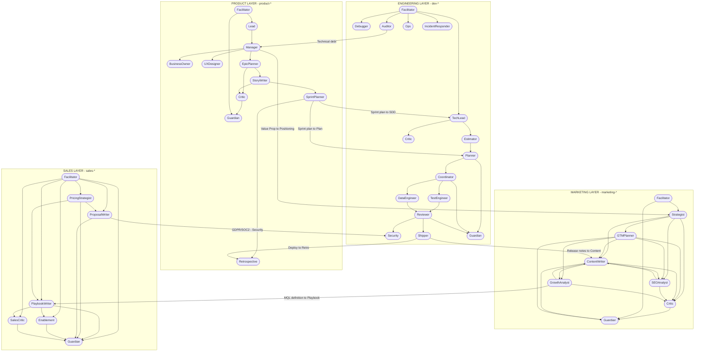

# agents-kit

A four-layer AI agent system for Claude Code, covering end-to-end software delivery from product discovery to production deploy. Forty-eight specialised subagents are organised into four pipelines plus a cross-cutting meta layer: **product-*** manages vision and requirements; **marketing-*** produces positioning, go-to-market and content; **sales-*** coordinates the sales process from lead to close; **dev-*** handles design, implementation and delivery. The agents ship as three Claude Code plugins from a single marketplace: `core` (dev + product + meta) is the base install, and `marketing` and `sales` are optional add-ons.

> For a real-world walkthrough, see [USE-CASE.md](USE-CASE.md) - it shows step by step how a product vision is carried from an idea to a production deploy.

---

## Quick start

Run these inside Claude Code:

```
/plugin marketplace add rbinar/agents-kit
/plugin install core@agents-kit
/plugin install marketing@agents-kit   # optional
/plugin install sales@agents-kit       # optional
```

Update later with:

```
/plugin marketplace update agents-kit
```

### Plugins

| Plugin | Agents | What it covers |
|---|---|---|
| `core` | 33 (21 `dev-*` + 11 `product-*` + 1 `meta-*`) | Product pipeline (goals, PRD, epics, stories, sprints, retrospectives), engineering pipeline (design, planning, implementation, testing, review, security, shipping, operations) and the meta quality evaluator |
| `marketing` | 8 (`marketing-*`) | Positioning, ICP, go-to-market, content, SEO, growth analytics and critique |
| `sales` | 7 (`sales-*`) | Playbooks, pricing, proposals/SOWs, enablement and deal-risk critique |

### Using the agents

Once installed, agents are namespaced by plugin: `core:dev-coordinator`, `marketing:marketing-strategist`, `sales:sales-critic`, and so on. Claude routes to them automatically from the agent descriptions, or you can invoke one explicitly:

```
@agent-core:dev-tech-lead Design the persistence layer for the task CRUD feature and record the decision as an ADR.
```

```
Use core:product-facilitator to classify this request: "We want to build a todo app."
```

Agents hand off to each other by bare name in their text (for example "hand off to dev-coordinator"); Claude maps that to the namespaced agent (`core:dev-coordinator`) automatically, so the pipelines keep flowing without extra configuration.

### Lifecycle commands

The `core` plugin ships six slash commands, one per lifecycle stage. Each runs in your main session and delegates to the right agents:

```
  DEFINE          PLAN           BUILD          VERIFY         REVIEW          SHIP
/core:spec  ->  /core:plan  ->  /core:build  ->  /core:test  ->  /core:review  ->  /core:ship
```

| Command | Stage | What it does |
|---|---|---|
| `/core:spec <idea>` | Define | Asks you clarifying questions, then `product-manager` writes the PRD |
| `/core:plan <PRD/story>` | Plan | `dev-tech-lead` writes the SDD, `dev-planner` turns it into a parallel implementation plan |
| `/core:build <plan>` | Build | `dev-coordinator` implements the plan |
| `/core:test [target]` | Verify | `dev-test-engineer` writes and runs tests; `dev-debugger` takes non-test failures |
| `/core:review [target]` | Review | `dev-reviewer`, plus `dev-security` for auth, infra, payments, secrets or personal data |
| `/core:ship [branch]` | Ship | `dev-shipper` verifies, updates the changelog, opens the PR, merges and tags, asking you before each outward step |

Agents that write files put their artefacts into **your project** under `.specs/` (and `.docs/` for `dev-doc-writer`) - see [Artefact Storage Strategy](#artefact-storage-strategy).

---

## Product Pipeline - product-* (plugin: core)

| Agent | Role | Mode |
|---|---|---|
| **product-facilitator** | Classifies incoming PM/product input and routes it to the right product-* agent - the first filter of the pipeline | Read-only |
| **product-guardian** | Evaluates product-* agent output, classifies risk and decides the next step | Read-only |
| **product-lead** | Turns founder/executive vision into a measurable Product Goal artefact | Read-write (`.specs/product/goals/`) |
| **product-manager** | Writes the PRD (Problem Definition) and Feature Specs - problem statement, user needs and requirements | Read-write (`.specs/product/prd/`, `.specs/product/features/`) |
| **product-business-owner** | Adds business input to a PRD from the revenue, market, regulation and KPI perspective | Read-only |
| **product-ux-designer** | Contributes user journeys, personas, flow diagrams and wireframe notes to a PRD or Feature Spec | Read-write (`.specs/product/ux/`) |
| **product-epic-planner** | Breaks a PRD into 3-7 manageable Epics - scope, acceptance criteria, T-shirt estimates and a dependency map | Read-write (`.specs/product/epics/`) |
| **product-story-writer** | Converts an Epic or Feature Spec into atomic INVEST user stories with Given-When-Then AC and a DoD | Read-write (`.specs/product/stories/`) |
| **product-critic** | Questions the depth, outcome focus and measurability of a PRD, Feature Spec, Epic or Story | Read-only |
| **product-sprint-planner** | Plans the story list against sprint capacity and dependencies - Sprint Goal, capacity calculation and risk map | Read-write (`.specs/product/sprints/`) |
| **product-retrospective** | Produces a retrospective for a finished sprint: went-well / went-wrong / learned findings and SMART action items | Read-write (`.specs/product/retrospectives/`) |

---

## Engineering Pipeline - dev-* (plugin: core)

| Agent | Role | Mode |
|---|---|---|
| **dev-facilitator** | Classifies incoming engineering work (bug/feature/refactor/infra/review) and routes it to the right dev-* agent | Read-only |
| **dev-guardian** | Evaluates dev-* agent output, classifies risk with concrete signals and steers the pipeline | Read-only |
| **dev-tech-lead** | Produces the SDD (Software Design Document) and ADR (Architecture Decision Record) from a story or sprint backlog | Read-write (`.specs/dev/sdd/`, `.specs/dev/adr/`) |
| **dev-estimator** | Estimates Story Points and person-days for a story, task or SDD using PERT + T-shirt sizing, with an uncertainty band | Read-only |
| **dev-planner** | Turns an SDD or sprint backlog into a file-based implementation plan with parallel waves | Read-only |
| **dev-coordinator** | Turns the implementation plan into code by delegating to parallel sub-agents; manages file conflicts | Read-write |
| **dev-test-engineer** | Derives test scenarios and test code from source/ACs and iterates with a write-run-fix loop | Limited write (test files + test config) |
| **dev-reviewer** | Standard PR review - code quality, surface-level security and structural issues | Read-only |
| **dev-security** | Deep threat-model audit for high-risk PRs (auth/infra/payments/GDPR scope) | Read-only |
| **dev-debugger** | Investigates test/build/runtime failures and performance issues through root cause analysis | Read-only |
| **dev-performance** | Measures slow or expensive code with profilers/benchmarks, finds bottlenecks with evidence and produces a prioritised optimisation plan | Read-only |
| **dev-failure-hunter** | Hunts swallowed errors, empty catch blocks, dangerous fallbacks and silent failures - a narrow-focus complement to dev-reviewer | Read-only |
| **dev-auditor** | Proactively scans the codebase for dead code, unused dependencies, complexity and technical debt | Read-only |
| **dev-spec-miner** | Extracts behavioural specs (Requirement + Invariant) from existing brownfield code, enabling a move to a spec-driven flow and regression testing | Read-write (`.specs/dev/specs/`) |
| **dev-refactorer** | Turns dev-auditor findings into behaviour-preserving, test-gated edits - removes dead code, duplication and complexity; never adds behaviour | Limited write (in-scope source, test-gated) |
| **dev-doc-writer** | Produces code-verified human-readable docs - architecture, API reference, onboarding guides - under `.docs/`; never invents | Read-write (`.docs/`) |
| **dev-data-engineer** | Produces forward + rollback scripts for schema migrations, index/constraint strategy and irreversible DB operations | Read-only (generates scripts) |
| **dev-ops** | Connects to remote servers over SSH; investigates system health, post-deploy validation and container issues | Terminal only |
| **dev-incident-responder** | Runs active P1/P2/P3 production incidents, coordinates mitigation and produces post-mortems | Read-write (`.specs/dev/incidents/`) |
| **dev-critic** | Probes the depth of an SDD, ADR or implementation plan - tests assumptions and flags overlooked risk | Read-only |
| **dev-shipper** | Validates the build, updates the CHANGELOG, commits, opens the PR, merges and tags | Read-write |

---

## Marketing Pipeline - marketing-* (plugin: marketing)

| Agent | Role | Mode |
|---|---|---|
| **marketing-facilitator** | Classifies incoming marketing/growth input and routes it to the right marketing-* agent - the first filter of the pipeline | Read-only |
| **marketing-guardian** | Evaluates marketing-* agent output, classifies risk, audits brand-voice consistency and decides the next step | Read-only |
| **marketing-strategist** | Produces positioning, ICP, message architecture and competitive map - the strategy layer | Read-write (`.specs/marketing/strategy/`) |
| **marketing-gtm-planner** | Produces the launch plan, channel mix, calendar and KPI targets - the go-to-market layer | Read-write (`.specs/marketing/gtm/`) |
| **marketing-content-writer** | Writes blog posts, landing pages, emails, social posts, changelogs and press releases - the production layer | Read-write (`.specs/marketing/content/`) |
| **marketing-seo-analyst** | Produces keyword strategy, technical SEO, schema recommendations and page audits - the search visibility layer | Read-write (`.specs/marketing/seo/`) |
| **marketing-growth-analyst** | Designs funnel analysis, A/B test hypotheses, experiment readouts, retention/cohort analysis, unit economics (LTV/CAC) and attribution models - the measurement and experimentation layer | Read-write (`.specs/marketing/analytics/`) |
| **marketing-critic** | Challenges the depth, proof-promise alignment and regulatory risk of positioning, launch plans, content and SEO/growth output | Read-only |

---

## Sales Pipeline - sales-* (plugin: sales)

| Agent | Role | Mode |
|---|---|---|
| **sales-facilitator** | Classifies sales input (lead, RFP, demo request, pricing question) and routes it to the right sales-* agent - the first filter of the pipeline | Read-only |
| **sales-guardian** | Evaluates sales-* agent output, classifies risk, triggers legal/security review gates and decides the next step | Read-only |
| **sales-playbook-writer** | Produces discovery questions, BANT/MEDDIC flows, objection handling guides and sales playbooks - the methodology layer | Read-write (`.specs/sales/playbooks/`) |
| **sales-pricing-strategist** | Produces packaging, pricing tiers, discount policy, ROI calculations and pricing-objection strategy - the pricing layer | Read-write (`.specs/sales/pricing/`) |
| **sales-proposal-writer** (high impact) | Produces proposals, SOWs, contract drafts and RFP responses - the closing layer. High impact: legal/security review is mandatory | Read-write (`.specs/sales/proposals/`) |
| **sales-enablement** | Produces demo scripts, battlecards, one-pagers, case studies and sales training material - the readiness layer | Read-write (`.specs/sales/enablement/`) |
| **sales-critic** | Deal-risk analysis, close probability, red flags, scope creep and depth challenge of sales-* artefacts (playbook/pricing/proposal/enablement) | Read-only |

---

## Meta / Quality Layer - meta-* (plugin: core)

Cross-cutting agents that apply to the output of **all pipelines** rather than to a single one.

| Agent | Role | Mode |
|---|---|---|
| **meta-evaluator** | Scores any agent's output (dev/product/marketing/sales) against a 5-axis rubric (accuracy, completeness, clarity, actionability, conciseness); produces an evidence-backed scorecard and a "ship / fix / redo" verdict | Read-only |

---

## Pipeline Architecture

Every pipeline follows the same three-role pattern, deliberately kept symmetrical:

- **Facilitator** - the entry point. Classifies the incoming request and routes it to the right specialist.
- **Guardian** - evaluates a specialist's output, classifies risk and decides the next step.
- **Critic** - challenges depth, assumptions and measurability before work moves on.

Domain-specific writer/analyst agents sit between these roles and produce the actual artefacts.



---

## Entry Points

### Starting from product

| Situation | Starting agent |
|---|---|
| Free-form PM request or vague product idea | `product-facilitator` |
| Set strategic vision or a north star | `product-lead` |
| Write a PRD or feature spec | `product-manager` |
| Epic breakdown needed | `product-epic-planner` |
| Convert to user stories | `product-story-writer` |
| Plan a sprint | `product-sprint-planner` |
| Run a sprint retrospective | `product-retrospective` |

### Starting from engineering

| Situation | Starting agent |
|---|---|
| Incoming task/bug/PR of unclear type | `dev-facilitator` |
| Architecture design or ADR needed | `dev-tech-lead` |
| Effort estimate needed | `dev-estimator` |
| Ready sprint, need an implementation plan | `dev-planner` |
| Turn the plan into code | `dev-coordinator` |
| Write tests or raise coverage | `dev-test-engineer` |
| Error or runtime failure | `dev-debugger` |
| Slowness / high memory / large bundle optimisation | `dev-performance` |
| Hunt for silent failures / swallowed errors | `dev-failure-hunter` |
| Codebase cleanup/quality analysis | `dev-auditor` |
| Extract a behavioural spec from spec-less legacy code (brownfield onboarding) | `dev-spec-miner` |
| Simplify working code without changing behaviour / dead-code cleanup | `dev-refactorer` |
| Generate documentation, API reference or onboarding guides from code | `dev-doc-writer` |
| DB schema change | `dev-data-engineer` |
| Production incident (P1/P2/P3) | `dev-incident-responder` |
| Server or deploy problem | `dev-ops` |
| Review a PR | `dev-reviewer` (add `dev-security` for auth/infra/payments/GDPR) |
| Ship approved code | `dev-shipper` |

### Starting from marketing

| Situation | Starting agent |
|---|---|
| Marketing input of unclear type (campaign/content/SEO/growth) | `marketing-facilitator` |
| Build positioning, ICP or message architecture | `marketing-strategist` |
| Launch plan, channel strategy or GTM calendar | `marketing-gtm-planner` |
| Write a blog post, landing page, email or social post | `marketing-content-writer` |
| Keyword strategy, SEO audit or schema recommendations | `marketing-seo-analyst` |
| Funnel analysis, A/B test hypothesis or metric definition | `marketing-growth-analyst` |
| Cohort/retention report or activation-moment hypothesis | `marketing-growth-analyst` |
| LTV/CAC (unit economics) calculation | `marketing-growth-analyst` |
| Attribution model or UTM scheme | `marketing-growth-analyst` |
| Interpret the result of a finished experiment (readout) | `marketing-growth-analyst` |

### Starting from sales

| Situation | Starting agent |
|---|---|
| Sales input of unclear type (lead/RFP/proposal/demo/pricing) | `sales-facilitator` |
| Discovery questions, BANT/MEDDIC framework or objection handling | `sales-playbook-writer` |
| Pricing model, discount policy or ROI calculation | `sales-pricing-strategist` |
| Proposal, SOW, contract draft or RFP response | `sales-proposal-writer` |
| Demo script, battlecard, one-pager or case study | `sales-enablement` |
| Deal-risk analysis, close-probability assessment or depth challenge of sales-* artefacts | `sales-critic` |

### Starting from meta / quality

| Situation | Starting agent |
|---|---|
| Score the quality of any agent output on 5 axes | `meta-evaluator` |

---

## Artefact Storage Strategy

Not every artefact has the same lifespan. The question is not "should we commit this to git?" but **"will this still be true in 6 months?"** There are three staleness profiles (A, B, C), plus two non-artefact categories (D, E).

### A) Immutable record - kept under `.specs/` forever

Once written, these **no longer change**; they are only superseded. They are institutional memory.

```
.specs/
├── product/
│   ├── goals/             <- product-lead             (quarterly vision - superseded)
│   └── retrospectives/    <- product-retrospective    (sprint learnings - frozen)
└── dev/
    ├── adr/               <- dev-tech-lead            (architecture decision - needs discipline, see below)
    └── incidents/         <- dev-incident-responder   (post-mortem - frozen)
```

**Naturally frozen**: incident post-mortems and retrospectives. They record a past incident/sprint, and their content can never be falsified later.

**Needs discipline - the ADR**: permanent in theory, but in practice it decays in three ways:

1. **Silent rot** - the code falsifies the ADR and nobody marks it `superseded`. Six months later a reader takes it as valid. This is more dangerous than a stale SDD, because it carries an "immutable truth" claim.
2. **Context erosion** - the ADR stays correct but its rationale stops being valid ("Mongo lacked X, so we chose Postgres" - now Mongo has it).
3. **Granularity error** - a code-comment-level decision ("retry 3 times") gets an ADR; when the code changes the ADR goes stale, and the "immutable" discipline forbids deleting it.

**ADR threshold** (open an ADR only for one of these):
- Choice of persistence/protocol/language/framework (DB, broker, cache, runtime)
- Breaking an existing API contract or changing a module boundary
- Inverting a dependency direction
- A one-way door that is expensive to reverse (more than 1 week)

**ADR update discipline**: if a new decision falsifies an old one, the old ADR is not deleted - the new ADR states "Supersedes ADR-0007" and the old ADR's status becomes `superseded by ADR-0024`. Without this discipline the ADR folder loses its credibility.

> **Plan revision triggers an ADR**: if a human revises the plan presented by the Planner and the revision crosses one of the thresholds above, it must be handed back to `dev-tech-lead` before moving on to the Coordinator. If the revision is only at the level of file paths, task order or implementation detail, no ADR is needed.

### B) Living document - updated under `.specs/` along with the product

Updated as product reality changes. When stale, moved under `archived/`.

```
.specs/
├── product/
│   ├── prd/               <- product-manager          (problem - archived when the feature dies)
│   ├── features/          <- product-manager          (spec - archived when the feature dies)
│   ├── business/          <- product-business-owner   (revenue/KPI/regulation addendum)
│   └── ux/                <- product-ux-designer      (persona - updated when users change)
├── dev/
│   └── specs/             <- dev-spec-miner           (brownfield behavioural spec - updated when code changes, archived/ when stale)
├── marketing/
│   ├── strategy/          <- marketing-strategist     (positioning - archived on pivot)
│   └── analytics/         <- marketing-growth-analyst (metrics.md, unit-economics.md, attribution.md - updated when north star/CAC/LTV/attribution model changes)
└── sales/
    ├── playbooks/         <- sales-playbook-writer    (discovery/objection - updated when ICP changes)
    ├── pricing/           <- sales-pricing-strategist (pricing model - updated when product/competitors change)
    ├── proposals/         <- sales-proposal-writer    (proposal/SOW - frozen once sent, Category A)
    └── enablement/        <- sales-enablement         (demo/battlecard - updated when product changes)
```

> **`.docs/` is a separate root** - `dev-doc-writer` output is written under `.docs/`, not `.specs/`. Why: `.specs/` holds product/decision artefacts ("what and why we did it"), while `.docs/` is a developer/user resource ("how it is built, how to use it"). It is still a Category B living document: updated when the code changes, moved under `.docs/archived/` when stale. Every file carries `source-commit` + `generated-at` + `status` frontmatter.

```
.docs/
├── architecture/     <- dev-doc-writer   (architecture overview - updated when code changes)
├── api/              <- dev-doc-writer   (API/interface reference - updated when signatures change)
└── guides/           <- dev-doc-writer   (setup/onboarding guides - updated when the flow changes)
```

> **Note:** `dev-refactorer` produces no artefacts; it edits source code directly while preserving behaviour (a writer like dev-coordinator), so it does not appear in the storage tables.

### C) Temporary working artefact - lives for the sprint/task

These **start going stale the moment the code becomes reality**. Their main value is not "output" but "coordination" - being the single source of truth the Coordinator can follow. After the task closes their reference value drops quickly; after 3-6 months it is usually more accurate to read the code.

| Artefact | Agent | When it goes stale |
|---|---|---|
| Epic | `product-epic-planner` | When all stories close - becomes history |
| Story | `product-story-writer` | When Done - AC accepted; body becomes history |
| Sprint plan | `product-sprint-planner` | When the sprint ends - retrospective reference |
| **SDD** | `dev-tech-lead` | **When the Coordinator finishes implementation - the code is real, the SDD freezes** |
| Implementation plan | `dev-planner` | When the Coordinator finishes - discard (it was only an execution tool) |
| Launch plan | `marketing-gtm-planner` | When the T+30 post-mortem completes - becomes history |
| Content (blog/landing/email) | `marketing-content-writer` | When published - becomes history; only active revisions are updated |
| SEO audit | `marketing-seo-analyst` | When the page/campaign is updated - replaced by a new audit |
| Experiment spec | `marketing-growth-analyst` | When the experiment closes - readout is written to frontmatter, file stays as history |
| Cohort report | `marketing-growth-analyst` | Refreshed periodically - previous report becomes history |
| Playbook (discovery/objection) | `sales-playbook-writer` | When ICP/persona changes - updated |
| Pricing model | `sales-pricing-strategist` | When product/feature/competitors change - updated |
| Proposal/SOW | `sales-proposal-writer` | When sent - frozen (Category A); revisions are new files |
| Demo script / battlecard | `sales-enablement` | When product/feature/competitors change - updated |
| Case study | `sales-enablement` | When published - frozen (Category A) |

There are two options for the SDD:

1. **Keep it**: store it under `.specs/dev/sdd/<feature-slug>.md` and add **`status: implemented` + commit-sha + date** to the frontmatter, so readers know it may be stale. Choose this only if SDD decisions are not reflected in code comments.
2. **Do not keep it (recommended)**: embed the SDD in the PR description or leave it on the feature branch; delete it after merge. Move the lasting part of the architectural decision into an **ADR**. The SDD is a **communication tool**, not a permanent document.

```
.specs/
└── dev/
    └── sdd/               <- optional; status frontmatter mandatory if kept
        └── archived/      <- SDDs whose implementation is complete go here
```

### D) Dies with the session - Claude Code session memory (never write to `.specs/`)

Left to Claude Code's own layers:

```
~/.claude/projects/<project-hash>/
├── <session-id>/session-memory/summary.md    <- automatic session summary
└── memory/MEMORY.md                          <- agent-learned patterns (~200 lines)
```

| Agent | Output | How it turns into a decision |
|---|---|---|
| `product-facilitator` / `dev-facilitator` / `marketing-facilitator` / `sales-facilitator` | Intake classification | Straight into the handoff; the report is discarded |
| `product-critic` / `dev-critic` / `marketing-critic` / `sales-critic` | Critique | Findings are reflected in the PRD/ADR/Story/positioning/content/playbook/proposal |
| `product-guardian` / `dev-guardian` / `marketing-guardian` / `sales-guardian` | Risk assessment | A routing decision; ends with the session |
| `dev-debugger` | RCA report | Fix goes to code; learnings go to an ADR or MEMORY.md |
| `dev-auditor` | Technical-debt scan | Findings become issues/PRD items |
| `dev-estimator` | SP/effort estimate | Reflected in the sprint plan; the report is discarded |

### E) Convention memory - `CLAUDE.md` + `MEMORY.md`

The pipeline rules themselves:

| File | Who writes it | Versioned? | Purpose |
|---|---|---|---|
| `./CLAUDE.md` (project root) | Human, manual | Yes | Project conventions, build commands |
| `~/.claude/CLAUDE.md` (user) | Human, manual | No (personal) | Individual preferences |
| `MEMORY.md` (auto-memory) | Agent, automatic | No | Patterns learned across sessions |

### `.gitignore` suggestion

```gitignore
# Claude Code - personal/session data
.claude/settings.local.json
.claude/memory/

# Temporary intake outputs (if used)
.specs/product/intake/
.specs/marketing/intake/
.specs/sales/intake/
```

> **General rule:** if an artefact will not be read in 6 months or will be falsified by the code, leave it in session memory instead of `.specs/`. `.specs/` is for things that answer an outside stakeholder's "why did we do it this way?" - not the Coordinator's "what do I do now?" notes.

---

## Pipeline Bridge

The layers connect to each other at specific handoff points:

```
# product <-> dev
product-sprint-planner → dev-tech-lead          (Sprint plan → SDD/design)
product-sprint-planner → dev-planner            (Sprint plan → Implementation plan, if TechLead is skipped)
dev-shipper            → product-retrospective  (Deploy → Sprint retrospective)
dev-auditor            → product-manager        (Technical debt → PRD update)

# product <-> marketing
product-manager        → marketing-strategist   (PRD Value Proposition → Positioning)
product-manager        → marketing-gtm-planner  (Feature Spec → Launch plan)

# dev <-> marketing
dev-shipper            → marketing-content-writer (Release notes → Changelog/blog)
dev-shipper            → marketing-gtm-planner    (Deploy → Launch trigger)

# marketing <-> sales
marketing-growth-analyst → sales-playbook-writer  (MQL definition → Qualification framework)
marketing-strategist     → sales-enablement       (Positioning → Battlecard)

# sales <-> dev
sales-proposal-writer  → dev-security             (GDPR/SOC2/ISO scope → Security audit)
```

**Bridge rules:**

| Layer | Question it answers | Boundary |
|---|---|---|
| product-* | **What** will we build, and for **whom**? | Problem and value definition |
| marketing-* | **Whom** do we tell, and **how** do we reach them? | Positioning, GTM, content, measurement |
| dev-* | **How** will we build it, and **when** do we deliver? | Design, implementation, operations |
| sales-* | **Whom** do we sell to, and **how** do we close? | Lead qualification, pricing, proposals, closing |

Cross-layer transitions flow only through the handoff points above. An agent making a cross-layer handoff outside them (for example marketing-content-writer handing off directly to dev-security) is **forbidden** - the bridge flows only through the points documented here. **One exception**: `sales-proposal-writer` → `dev-security` (for contracts with GDPR/SOC2/ISO scope).

Because the layers are split across plugins, the cross-plugin handoffs above (for example `dev-shipper` to `marketing-content-writer`) only work when the target plugin is installed. Bare-name handoffs are resolved to the namespaced agent (for example `marketing:marketing-content-writer`) automatically.
