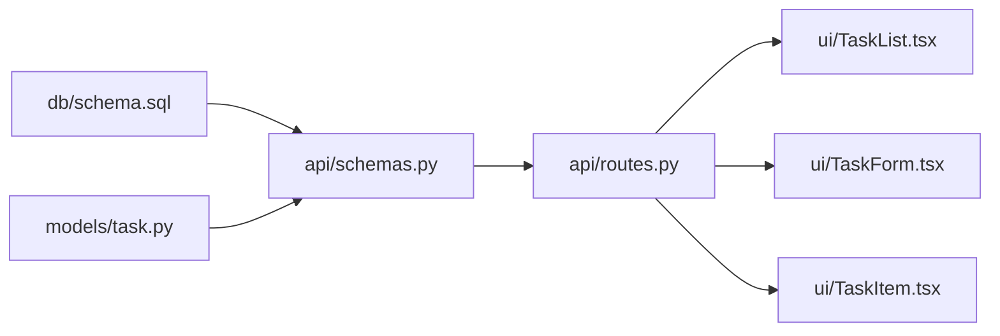

# Use Case - Todo App

This scenario shows step by step how a vague idea that starts as "we want to build a todo app" travels through the agent pipelines and becomes a production deploy. At every step you can see which agent runs, what it produces and where the output is written inside `.specs/`.

Agent names below are shown in their short form. When installed from the marketplace they are namespaced by plugin (for example `sdlc:product-facilitator`, `sdlc:dev-tech-lead`); agents hand off to each other by bare name and Claude resolves the namespaced agent automatically.

---

## Overall Flow

```
product-facilitator
  └─► product-lead          → .specs/product/goals/
        └─► product-manager → .specs/product/prd/ + .specs/product/features/
              ├─► product-ux-designer   → .specs/product/ux/
              └─► product-epic-planner  → .specs/product/epics/
                    └─► product-story-writer  → .specs/product/stories/
                          └─► product-sprint-planner → .specs/product/sprints/
                                │
                                ▼ (bridge)
                          dev-tech-lead  → .specs/dev/sdd/ + .specs/dev/adr/
                                └─► dev-planner  (session memory)
                                      └─► dev-coordinator (parallel sub-agents)
                                            ├─► dev-test-engineer
                                            ├─► dev-reviewer
                                            └─► dev-shipper
                                                  └─► product-retrospective → .specs/product/retrospectives/
```

---

## Part 1 - Product Pipeline

### 1.1 `product-facilitator`

**Triggered by:** the team lead typing the following into Claude Code, naming the agent explicitly:

```
@agent-sdlc:product-facilitator We want to build a todo app. Users should be able to add tasks and complete them.
```

**What it does:** Classifies the input. This is a product vision - there is no PRD yet and the scope is unclear. Instead of jumping straight to `product-manager`, it routes to `product-lead` first.

**Output:** A routing decision (session memory - it does not write to `.specs/`).

```
Classification: New product idea / vision stage
Routing: product-lead
Rationale: Scope, target audience and success criteria are still undefined.
           product-lead must first produce a measurable Product Goal.
```

---

### 1.2 `product-lead`

**Triggered by:** the facilitator handoff.

**What it does:** Converts the free-form vision into a structured Product Goal artefact. Written outcome-first - it is not a feature list, it answers the question of why we are doing this.

**Output file:** `.specs/product/goals/todo-app-goal.md`

> **Artefact Category: A - Immutable record.** Written once; unchanged unless superseded.

```markdown
---
title: Todo App - Product Goal
version: 1.0
date: 2026-05-09
status: active
---

## Problem

Small developer teams track their tasks through Slack messages or physical notes.
This approach causes losses and makes prioritisation harder.

## Target Outcome

By the end of the sprint, 70% of the team does daily task tracking with this tool.

## Success Metrics

- DAU/MAU ratio >= 0.5 after 14 days
- Average task create -> complete cycle < 3 days
- NPS >= 40 (first 30 users)

## Out of Scope (At This Stage)

- Sharing between team members
- Mobile app
- Notification system

## Time Frame

First usable release: 3 sprints (6 weeks)
```

---

### 1.3 `product-manager`

**Triggered by:** the Product Goal file.

**What it does:** Makes the Goal concrete in two separate artefacts: the PRD (problem definition) and a Feature Spec (details of the first feature).

**Output files:**
- `.specs/product/prd/todo-app-prd.md`
- `.specs/product/features/task-crud.md`

> **Artefact Category: B - Living document.** Updated as product reality changes.

```markdown
---
title: Todo App PRD
version: 1.2
status: active
last-updated: 2026-05-09
---

## Problem Definition

Developer teams need a lightweight task-tracking tool that works alongside the code editor.
Existing tools (Jira, Notion) are too heavy for this segment.

## User Personas

**Solo Dev** - Freelancer or side-project owner. Wants to minimise context switching.
**Team Lead** - Wants to make the priorities of a 3-8 person team visible.

## User Needs

1. Add, edit, delete and complete tasks
2. Prioritisation (high / medium / low)
3. Due date assignment
4. Simple filtering (active / completed)

## Success Metrics

The metrics in goal.md apply + fewer than 3 critical bug reports in the first 7 days.

## Out of Scope

Same as goal.md.
```

```markdown
---
title: Feature Spec - Task CRUD
epic: task-management
status: active
---

## Description

The core flow in which a user creates, updates, deletes and marks tasks as completed.

## User Flow (Core)

1. Empty list -> "New task" button -> modal opens
2. Title (required), description (optional), priority, due date -> Save
3. Checkbox in the list view -> completed
4. Edit / delete actions on row hover

## API Endpoints (Expected)

POST   /tasks
GET    /tasks?status=active
PATCH  /tasks/:id
DELETE /tasks/:id

## Acceptance Criteria

- The form does not submit if the title is empty
- Completed tasks appear in a separate tab
- Deletion requires confirmation
```

---

### 1.4 `product-ux-designer` *(optional)*

**What it does:** Reads the PRD and produces a user journey and wireframe notes. Identifies the flows in which the developer persona experiences friction.

**Output file:** `.specs/product/ux/todo-app-user-journey.md`

> **Artefact Category: B - Living document.** Updated when user behaviour changes.

```markdown
---
title: UX - Todo App User Journey
persona: Solo Dev
status: active
---

## Critical Flow: Creating the First Task

Step 1 -> App opens, empty list + prominent "+" button
Step 2 -> Modal: title is focused, other fields appear optional
Step 3 -> Save -> task appears in the list instantly (optimistic update)
Step 4 -> Checkbox -> animated completion

## Friction Points

- Making priority selection mandatory burdens the first experience -> leave it optional
- The delete confirmation dialog needs only one line of text + "Delete" / "Cancel"

## Wireframe Notes

List view:
[ ] High    |  API endpoint optimisation       |  12 May  |  edit / delete
[x] Medium  |  Update README                   |  -       |  edit / delete
```

---

### 1.5 `product-business-owner` *(optional)*

**What it does:** Adds a revenue and KPI perspective to the PRD. This sprint is only building basic CRUD, so the business output is left on the sidelines for now.

**Output:** A session memory note - it may trigger a PRD update later. It does not write to `.specs/`.

```
Freemium threshold: 5 active tasks free, premium above that.
KPI: Sign-up -> first task creation conversion >= 80% (onboarding quality indicator).
Out of scope for now, evaluate in Sprint 3.
```

---

### 1.6 `product-epic-planner`

**Triggered by:** the PRD + Feature Spec.

**What it does:** Breaks the PRD into 3-7 Epics. Each epic is an independently deliverable slice of value.

**Output file:** `.specs/product/epics/todo-epics.md`

> **Artefact Category: C - Temporary working artefact.** Becomes history when all stories close.

```markdown
---
title: Todo App - Epic List
status: active
created: 2026-05-09
---

## Epic 1 - Task CRUD [M]

**Scope:** Create, list, update, delete and complete tasks
**Dependency:** None - first sprint
**Acceptance Criteria:** All CRUD operations work, basic filter (active/completed) exists
**T-shirt:** M (1 sprint)

## Epic 2 - User Auth [L]

**Scope:** Sign-up, login, session management, task ownership
**Dependency:** Epic 1 must be complete
**T-shirt:** L (1.5 sprints)

## Epic 3 - Collaboration [XL]

**Scope:** Task sharing, comments, notifications
**Dependency:** Epic 2 must be complete
**T-shirt:** XL (2+ sprints)
**Note:** Planned for now; the scope will be clarified at the start of Sprint 3
```

---

### 1.7 `product-story-writer`

**Triggered by:** Epic 1 (Task CRUD).

**What it does:** Converts the epic into atomic User Stories that meet the INVEST criteria. Each story contains AC in Given/When/Then format and a Definition of Done.

**Output file:** `.specs/product/stories/task-crud-stories.md`

> **Artefact Category: C - Temporary working artefact.** Once Done, the AC is accepted; the body becomes history.

```markdown
---
title: User Stories - Task CRUD
epic: task-management
sprint: 1
status: active
---

## US-001: Task Creation

**Story:** As a user, I want to create a new task
so that I can keep a record of what I need to do.

**Acceptance Criteria:**

Given: I am on the task list page
When: I click "New task", enter a title and save
Then: The task appears at the top of the list with active status

Given: I leave the title field empty and save
When: The form is submitted
Then: Nothing is saved and a "Title is required" error is shown

**Definition of Done:**
- [ ] Unit test: empty title validation
- [ ] Integration test: POST /tasks succeeds + returns 201
- [ ] UI: the task appears in the list immediately (optimistic update)
- [ ] Code review passed

**Story Points:** 3
**INVEST:** Independent ✓ | Negotiable ✓ | Valuable ✓ | Estimable ✓ | Small ✓ | Testable ✓

---

## US-002: Task Listing

**Story:** As a user, I want to see my current tasks
so that I can understand what is pending.

**Acceptance Criteria:**

Given: When the app opens
When: The list page loads
Then: Active tasks are listed sorted by priority

Given: I switch to the "Completed" tab
Then: Only completed tasks are visible

**Story Points:** 2

---

## US-003: Task Completion

**Story:** As a user, I want to mark a task as completed.

**Acceptance Criteria:**

Given: I have an active task
When: I click the checkbox
Then: The task moves to the completed list, shown with a strikethrough

**Story Points:** 2

---

## US-004: Task Editing

**Story Points:** 3

## US-005: Task Deletion

**Story Points:** 2

## US-006: Prioritisation

**Story Points:** 3

## US-007: Due Date Assignment

**Story Points:** 3

## US-008: Basic Filtering

**Story Points:** 2

**Total Sprint Estimate:** 20 SP
```

---

### 1.8 `product-critic` *(optional)*

**What it does:** Questions the stories for measurability, scope clarity and outcome focus.

**Output:** Critique in session memory. If a story is revised, `.specs/product/stories/` is updated.

```
US-003: "shown with a strikethrough" is an implementation detail and should not be in the AC.
         The AC should be: "The task appears in the completed list."
         The UX decision should stay in the Feature Spec.

US-006: The priority field already exists in the create story (US-001).
         Is this story for a separate "change priority" flow?
         The scope needs to be clarified.
```

---

### 1.9 `product-sprint-planner`

**Triggered by:** the story list + team capacity.

**What it does:** Orders the stories against sprint capacity and dependencies. Produces a sprint goal, a risk map and a velocity estimate.

**Output file:** `.specs/product/sprints/sprint-1-plan.md`

> **Artefact Category: C - Temporary working artefact.** Becomes history when the sprint ends, serving as the retrospective reference.

```markdown
---
title: Sprint 1 Plan - Task CRUD
dates: 2026-05-12 / 2026-05-23
team-capacity: 40 SP (2 devs × 10 days × 2 SP/day)
committed: 20 SP
status: planned
---

## Sprint Goal

By the end of the sprint, a user must be able to create, list,
complete and delete tasks. The basic filter (active/completed) must work.

## Committed Stories

| Story | SP | Priority |
|---|---|---|
| US-001 Task Creation | 3 | High |
| US-002 Task Listing | 2 | High |
| US-003 Task Completion | 2 | High |
| US-004 Task Editing | 3 | Medium |
| US-005 Task Deletion | 2 | Medium |
| US-006 Prioritisation | 3 | Medium |
| US-007 Due Date Assignment | 3 | Low |
| US-008 Filtering | 2 | Low |
| **Total** | **20** | |

## Capacity

Available: 40 SP | Committed: 20 SP | Buffer: 20 SP (first sprint, new team)

## Risk Map

| Risk | Likelihood | Impact | Mitigation |
|---|---|---|---|
| API is delayed if the DB schema is settled late | Medium | High | SDD + ADR will be completed on day 1 of the sprint |
| US-007 due date UI may get complicated | Low | Medium | Text input fallback instead of a date picker |

## Dependencies

US-001 -> US-003, US-004, US-005 (create first, then the others)
US-002 -> US-008 (listing first, then the filter)
```

---

## Part 2 - Pipeline Bridge

`product-sprint-planner` → `dev-tech-lead`

When the sprint plan is complete, the engineering pipeline starts. The sprint backlog (`.specs/product/sprints/sprint-1-plan.md`) is handed directly to `dev-tech-lead`. The TechLead reads this plan and designs not *what* will be done but *how* - producing a Software Design Document (SDD) and, where needed, an Architecture Decision Record (ADR).

---

## Part 3 - Dev Pipeline

### 3.1 `dev-tech-lead`

**Triggered by:** the sprint plan + Feature Spec + PRD.

**What it does:** Makes the architectural decisions, draws the module map and defines the API contract. Produces two artefacts: the SDD (how we will do it) and the ADR (why we made this decision - the persistence choice meets the ADR threshold).

**Output files:**
- `.specs/dev/sdd/task-crud-sdd.md`
- `.specs/dev/adr/adr-001-sqlite-vs-postgres.md`

> **SDD - Artefact Category: C.** When the Coordinator finishes implementation, `status: implemented` + `commit-sha` are added to the frontmatter.
> **ADR - Artefact Category: A - Immutable record.** The persistence choice is a one-way door that is expensive to reverse.

```markdown
---
title: SDD - Task CRUD
sprint: 1
status: in-design
related-adr: adr-001
---

## Module Map

db/
  schema.sql          - tasks table, indexes
models/
  task.py             - Task dataclass, validation
api/
  routes.py           - FastAPI router, CRUD endpoints
  schemas.py          - Pydantic request/response models
ui/
  TaskList.tsx        - List + filter
  TaskForm.tsx        - Create/edit modal
  TaskItem.tsx        - Single row, checkbox + actions

## API Contract

POST   /tasks         body: {title, description?, priority?, due_date?}
GET    /tasks         query: status (active|completed|all), default: active
PATCH  /tasks/{id}    body: partial task fields
DELETE /tasks/{id}    -

All endpoints return 422 validation, 404 not-found, 500 server error.

## Tech Stack

Backend: Python 3.12 + FastAPI + SQLite (see ADR-001)
Frontend: React 18 + TypeScript + TailwindCSS
Test: pytest (API) + Vitest (UI)

## Dependency Order

schema.sql -> task.py -> schemas.py -> routes.py -> UI components
```

```markdown
---
id: ADR-001
title: Persistence - SQLite vs PostgreSQL
date: 2026-05-12
status: accepted
deciders: [tech-lead, team-lead]
---

## Context

A persistence layer must be chosen for the Task CRUD sprint.
Deployment target: single server, single developer. A move to PostgreSQL can be planned as the team grows.

## Decision

**SQLite** - sufficient for starting the application, zero infrastructure cost.

## Rationale

- The initial user base is < 100, concurrent writes will rarely occur
- Local development and prod use the same binary - no infrastructure complexity
- The migration path is open: moving to PostgreSQL is possible via the SQLAlchemy ORM

## Consequences

If a concurrent-write need or team growth arises, we will move to PostgreSQL with ADR-002.
This decision was assessed as < 1 week of work to reverse.

## Alternatives

PostgreSQL: setup overhead is disproportionate for this stage.
Redis: not suitable for CRUD.
```

---

### 3.2 `dev-estimator` *(optional)*

**What it does:** Reviews the SDD and gives a Story Point and person-day estimate using PERT + T-shirt sizing. This step can be skipped if the sprint plan is already ready; it is brought in when the SDD reveals unforeseen complexity.

**Output:** Session memory - if the estimate conflicts with the sprint plan, `product-sprint-planner` is called again.

---

### 3.3 `dev-planner`

**Triggered by:** the SDD.

**What it does:** Produces a file-based parallel implementation plan from the SDD. Determines which files will be written in what order by which sub-agent, and the wave order that eliminates conflicts.

**Output:** Session memory - handed straight to `dev-coordinator`.

```
Implementation Plan - Task CRUD

Wave 1 (parallel, no conflicts):
  T1: db/schema.sql      - tasks table, priority enum, indexes
  T2: models/task.py     - Task dataclass, field validation

Wave 2 (as soon as T1+T2 finish, parallel):
  T3: api/schemas.py     - Pydantic models (depends on task.py)
  T4: (wait)

Wave 3 (as soon as T3 finishes):
  T5: api/routes.py      - FastAPI CRUD (depends on schemas.py)

Wave 4 (as soon as T5 finishes, parallel):
  T6: ui/TaskList.tsx    - List + filter (depends on API contract, after T5)
  T7: ui/TaskForm.tsx    - Modal (after T5)
  T8: ui/TaskItem.tsx    - Row component (after T5)

File conflicts: None. Each file is assigned to a single sub-agent in a single wave.
```

---

### 3.4 `dev-coordinator` (parallel sub-agents)

**Triggered by:** the implementation plan.

**What it does:** Takes the plan and delegates each wave to parallel sub-agents. Validates the sub-agent contract. Synthesises all outputs. Updates the SDD to `status: implemented`.

**Mermaid dependency graph:**



**Wave 1 - Parallel:**

```
Sub-agent T1 task: write db/schema.sql
  - tasks table: id, title, description, priority, due_date, status, created_at
  - priority: CHECK constraint (high/medium/low)
  - index: on the status column

Sub-agent T2 task: write models/task.py
  - Task dataclass (frozen=True)
  - Field validation: title cannot be empty, priority enum
  - from_row() factory method
```

**Sub-agent contract output (T1 example):**

```json
{
  "summary": "SQLite schema for the tasks table created",
  "modified_files": ["db/schema.sql"],
  "decisions": ["priority field uses a TEXT CHECK constraint instead of an enum - SQLite compatible"],
  "risks": ["CHECK constraint syntax will change in a future PostgreSQL migration"],
  "followups": ["Noted in ADR-001: migration path is open"]
}
```

**SDD update (when implementation is complete):**

```markdown
---
title: SDD - Task CRUD
sprint: 1
status: implemented          <- updated
implemented-at: 2026-05-20
commit-sha: a3f7c2d
---
```

---

### 3.5 `dev-test-engineer`

**Triggered by:** Coordinator output (API routes ready).

**What it does:** Turns the US-001 acceptance criteria into test scenarios. Iterates with a write-run-fix loop.

**Output:** Test files (inside the project - it does not write to `.specs/`).

```python
# tests/test_tasks.py

def test_create_task_success(client):
    response = client.post("/tasks", json={"title": "API optimisation"})
    assert response.status_code == 201
    assert response.json()["title"] == "API optimisation"
    assert response.json()["status"] == "active"

def test_create_task_empty_title(client):
    response = client.post("/tasks", json={"title": ""})
    assert response.status_code == 422

def test_list_active_tasks(client, sample_tasks):
    response = client.get("/tasks?status=active")
    assert response.status_code == 200
    assert all(t["status"] == "active" for t in response.json())

def test_complete_task(client, sample_task):
    response = client.patch(f"/tasks/{sample_task['id']}", json={"status": "completed"})
    assert response.status_code == 200
    assert response.json()["status"] == "completed"
```

---

### 3.6 `dev-reviewer`

**Triggered by:** a PR being opened.

**What it does:** Code quality, structural issues, surface-level security check. This PR has no auth, so `dev-reviewer` alone is enough (`dev-security` is skipped).

**Output:** Review notes in session memory -> the developer fixes them.

```
MUST FIX:
  api/routes.py:47 - DELETE endpoint returns 200 instead of 404 (when the resource is not found).
  models/task.py:23 - title validation does not catch the None case.

SUGGESTION:
  api/routes.py - limit/offset pagination could be added to GET /tasks (next sprint).
  ui/TaskForm.tsx - error-state loading spinner is inconsistent with the other forms.

APPROVED (after fixes)
```

---

### 3.7 `dev-security` *(for high-risk PRs)*

**For this sprint:** Task CRUD has no auth and input validation is done with Pydantic. `dev-reviewer` is enough.

**Comes into play:** when the Epic 2 (User Auth) PR arrives - `dev-security` is mandatory because of JWT handling, session storage and GDPR scope.

---

### 3.8 `dev-shipper`

**Triggered by:** review approval.

**What it does:** Validates the build, updates the CHANGELOG, commits, creates the PR, merges and tags.

**Flow:**

```
1. pytest + vitest - all tests pass ✓
2. CHANGELOG.md updated - [Unreleased] -> [v0.1.0]
3. git commit + PR opened
4. PR merged -> main
5. git tag v0.1.0
6. -> product-retrospective handoff
```

---

## Part 4 - Post-Deploy

### 4.1 `product-retrospective`

**Triggered by:** after `dev-shipper` completes the deploy.

**What it does:** Extracts the went-well / went-wrong / learned findings for Sprint 1 and produces SMART action items.

**Output file:** `.specs/product/retrospectives/sprint-1-retro.md`

> **Artefact Category: A - Immutable record.** It is the record of a past sprint and freezes.

```markdown
---
title: Sprint 1 Retrospective
sprint: 1
date: 2026-05-23
facilitator: product-retrospective
---

## Went Well

- Wave-based parallel development delivered more speed than expected (finished 3 days early)
- Writing the SDD up front reduced API contract ambiguity to zero
- ADR-001 provided the rationale for the decision; the question "why SQLite?" came up twice during the sprint and the ADR was cited

## Went Wrong

- The US-007 (due date) UI turned out more complex than expected; the text input fallback
  decision should have been taken at the start of the sprint, not during it
- product-critic flagged the US-006 scope but the story revision was delayed and went
  into Sprint Planning as is; an early critique loop should be set up

## Learned

- The first-sprint buffer (50%) was justified - velocity this sprint: 22 SP (estimate: 20)
- The `dev-reviewer` + `dev-test-engineer` loop caught bugs before the PR

## SMART Action Items

1. Before Sprint 2 Planning, product-critic will review the stories (due: 2026-05-26)
2. UI complexity risks like US-007 will be shown to product-ux-designer early (standing rule)
3. ADR update discipline: from Sprint 2 on, the TechLead reviews the ADRs at the end of every sprint
```

---

### 4.2 `dev-auditor` *(before Sprint 2)*

**Triggered by:** after Sprint 1 closes, before Sprint 2 starts.

**What it does:** Scans the codebase for dead code, unused dependencies, complexity hotspots and technical debt.

**Output:** A technical-debt list in session memory -> critical findings are passed to `product-manager` -> they enter the PRD as backlog items.

```
Technical Debt Findings - After Sprint 1:

LOW RISK:
  api/routes.py - GET /tasks has no pagination; performance degrades above 500 records.
  models/task.py - from_row() silently returns None on error.

NOTE:
  The SQLite -> PostgreSQL migration path is documented in ADR-001.
  The connection pool architecture must be clarified before Epic 2 (Auth) starts.

-> To product-manager: add pagination to the backlog (Sprint 3 proposal)
```

---

## Part 5 - The `.specs/` Structure: The Completed Scenario

The `.specs/` tree at the end of Sprint 1 and the category of each artefact:

```
.specs/
├── product/
│   ├── goals/
│   │   └── todo-app-goal.md              (A) Immutable record - untouched unless superseded
│   ├── prd/
│   │   └── todo-app-prd.md               (B) Living document - updated if Sprint 2 scope grows
│   ├── features/
│   │   └── task-crud.md                  (B) Living document - updated as the feature evolves
│   ├── ux/
│   │   └── todo-app-user-journey.md      (B) Living document - updated with user feedback
│   ├── epics/
│   │   └── todo-epics.md                 (C) Temporary - becomes history when all stories close
│   ├── stories/
│   │   └── task-crud-stories.md          (C) Temporary - once Done, AC accepted, body becomes history
│   ├── sprints/
│   │   └── sprint-1-plan.md              (C) Temporary - history when the sprint ends, retro reference
│   └── retrospectives/
│       └── sprint-1-retro.md             (A) Immutable record - record of a past sprint, frozen
└── dev/
    ├── sdd/
    │   └── task-crud-sdd.md              (C) Temporary - status: implemented + commit-sha added
    └── adr/
        └── adr-001-sqlite-vs-postgres.md (A) Immutable record - replaced via a superseding ADR
```

### Categories

| Category | Definition | Example |
|---|---|---|
| **A - Immutable record** | Written once, superseded, never deleted | Goal, ADR, Retro, Post-mortem |
| **B - Living document** | Updated along with the product; `archived/` when the feature dies | PRD, Feature Spec, UX |
| **C - Temporary artefact** | Lives for the sprint/task; then history | Epic, Story, Sprint Plan, SDD |
| **D - Session memory** | Ends with the session; never written to `.specs/` | Facilitator intake, Critic note, Guardian decision |

---

## Summary: Which Agent to Use When

| Situation | Agent |
|---|---|
| A vague product idea arrived | `product-facilitator` |
| Turn the vision into a measurable goal | `product-lead` |
| Write a PRD or feature spec | `product-manager` |
| A user journey or wireframe is needed | `product-ux-designer` |
| Break the PRD into epics | `product-epic-planner` |
| Produce user stories from an epic | `product-story-writer` |
| Arrange the stories into a sprint | `product-sprint-planner` |
| An architecture decision or SDD is needed | `dev-tech-lead` |
| An effort estimate is needed | `dev-estimator` |
| Produce an implementation plan from the SDD | `dev-planner` |
| Turn the plan into code (parallel) | `dev-coordinator` |
| Write tests or raise coverage | `dev-test-engineer` |
| Review a PR | `dev-reviewer` |
| An auth/infra/payments PR | `dev-security` |
| Build, CHANGELOG, merge, tag | `dev-shipper` |
| Sprint retrospective | `product-retrospective` |
| Scan for technical debt | `dev-auditor` |
